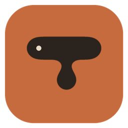
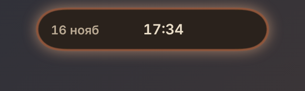
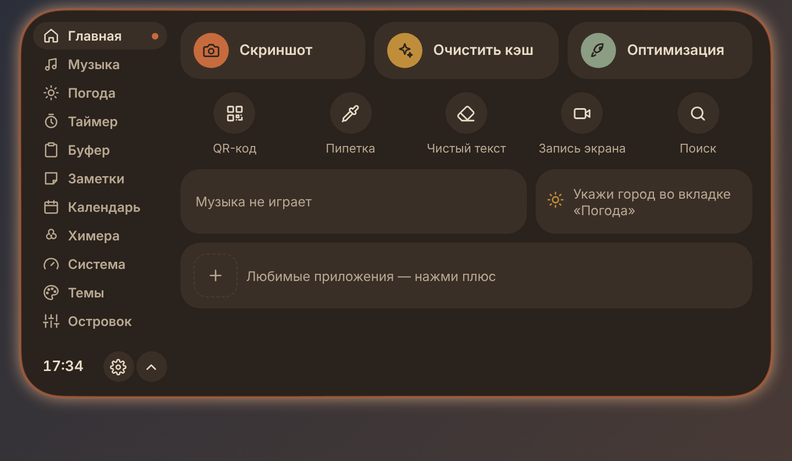
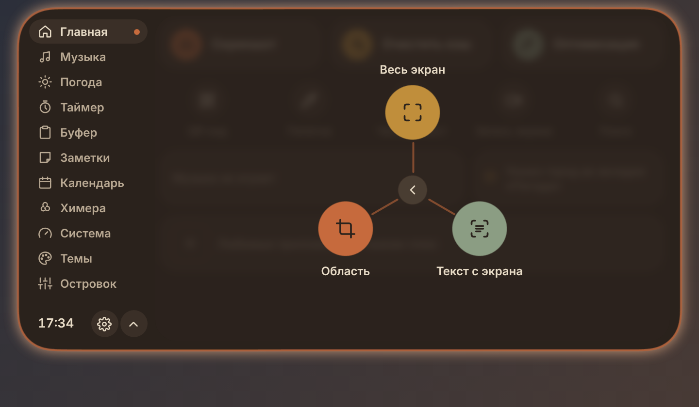
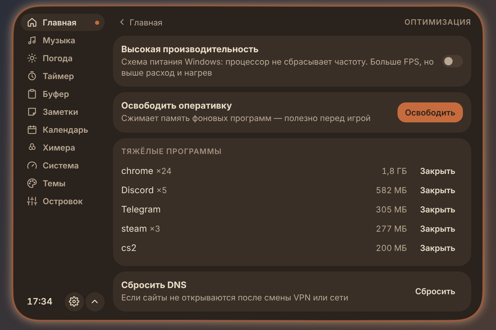
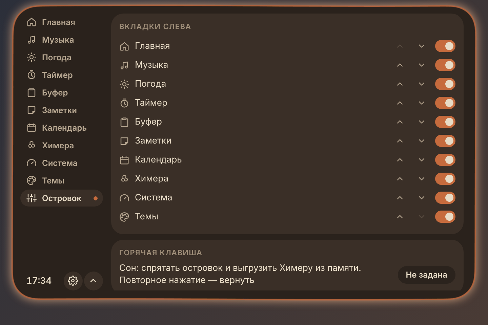
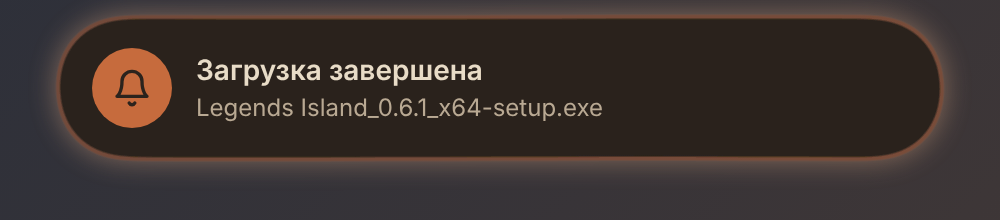
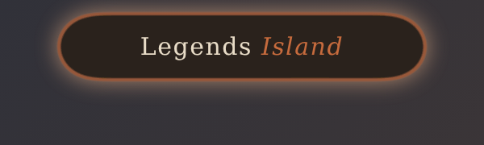

<div align="center">



# Legends Island

**Dynamic Island для Windows и Linux.** Живая «капля» сверху экрана: музыка, уведомления, погода, буфер, заметки, скриншоты, оптимизация ПК и своя локальная нейросеть Химера — без интернета.

[](https://island.lgscode.online)
[](https://island.lgscode.online)
[](https://tauri.app)
[](https://www.rust-lang.org)
[](LICENSE)

[**Скачать**](https://island.lgscode.online) · [Возможности](#возможности) · [Химера](#химера--своя-нейросеть) · [Сборка](#сборка)



</div>

---

## Возможности



| | |
|---|---|
| **Островок-желе** | Тянется к курсору оранжевым краем, отрывает капли, пульсирует под музыку. Прячется в полоску свайпом вверх, в полноэкранных играх — сам. |
| **Главная** | Скриншот (весь экран / область / текст с экрана), очистка кэша, оптимизация ПК, QR-код, пипетка, запись экрана, любимые приложения. |
| **Музыка** | Трек, обложка, управление и текст песни. |
| **Уведомления** | Загрузки, Telegram (через системные уведомления, без входа в аккаунт), таймеры. Подряд — собираются в стопку «+N». |
| **Не беспокоить** | Долгое нажатие на островок: 30 мин / 1 час / до утра. Пропущенное покажется потом. |
| **Игровой режим** | FPS, CPU и GPU прямо в пилюле. |
| **Химера** | Своя нейросеть, работает на твоей видеокарте без интернета. |
| **Темы** | Редактор тем с кодами «поделиться», желе по краю, отрыв капель. |
| **Горячая клавиша «сон»** | Одно сочетание — островок прячется и выгружает Химеру из памяти. |
| **Обновления** | Интерфейс обновляется сам за секунды, приложение — одной кнопкой. |

<table>
<tr>
<td width="50%"><br><sub>Скриншот: три режима треугольником</sub></td>
<td width="50%"><br><sub>Оптимизация: питание, оперативка, тяжёлые программы, DNS</sub></td>
</tr>
<tr>
<td><br><sub>Вкладка «Островок»: вкладки, пилюля, уведомления, звук, шрифт</sub></td>
<td><br><sub>Уведомление</sub><br><br><br><sub>Заставка при запуске</sub></td>
</tr>
</table>

## Химера — своя нейросеть

**Legends Chimera** — модель от Legends team на базе Qwen3.5-9B, дообученная на своих диалогах: русский язык, рассуждения (think) и вызов инструментов. Ставится из настроек островка с прогрессом и докачкой при обрыве, работает локально через `llama.cpp` (Vulkan).

| Версия | Квант | Размер | Для чего |
|---|---|---|---|
| **Химера 9B** | Q4_K_M | 5,8 ГБ | Максимум качества, видеокарта от 8 ГБ |
| **Chimera Flash** | Q3_K_M + imatrix | 4,7 ГБ | Для быстрой работы, влезает целиком в 6 ГБ видеопамяти |

Веса GGUF слишком большие для Git — островок скачивает их сам с сервера обновлений (`/ai/manifest.json`). Контекст — 4096 токенов.

## Как это устроено

```
ui/                 интерфейс (HTML/CSS/JS) — подписывается и обновляется «на лету»
  island-app.html   сам островок: желе, капли, вкладки, Химера
  settings-app.html окно настроек
  hot.js            проверка подписи и горячая подгрузка интерфейса
src-tauri/src/      Rust: окна, системные события, медиа, уведомления
  ai.rs             установка и запуск Химеры (llama.cpp)
  tune.rs           очистка кэша и оптимизация ПК
  win.rs / lin.rs   платформенный код Windows / Linux
site/               страница загрузки
```

Интерфейс подписывается ключом ECDSA (`publish-ui.sh`), приложение — ключом Tauri updater. Без подписи островок не примет ни интерфейс, ни обновление.

## Сборка

Нужны Node.js 18+, Rust (stable) и зависимости Tauri 2 для своей ОС.

```bash
npm install
npx tauri dev          # запуск в режиме разработки
npx tauri build        # сборка установщика под текущую ОС
```

`build.sh` и `release-all.sh` — скрипты автора для кросс-сборки Windows-версии на Linux (`cargo-xwin`) и выпуска релиза. Для подписи обновлений нужны свой ключ (`npx tauri signer generate`) и переменная `TAURI_SIGNING_PRIVATE_KEY_PASSWORD`.

## Лицензия

[GPL-3.0](LICENSE) © 2026 Legends team. Можно изучать, менять и распространять — но любая изменённая версия тоже должна оставаться открытой под GPL-3.0 с указанием авторства. Название «Legends Island», логотип и модель Химера в лицензию не входят.

## Благодарности

- [Tauri](https://tauri.app) — оболочка приложения
- [llama.cpp](https://github.com/ggml-org/llama.cpp) — запуск Химеры
- [PresentMon](https://github.com/GameTechDev/PresentMon) — FPS в игровом режиме (лицензия в `src-tauri/resources`)

<div align="center">
<sub>Сделано <b>Legends team</b> · <a href="https://island.lgscode.online">island.lgscode.online</a></sub>
</div>
